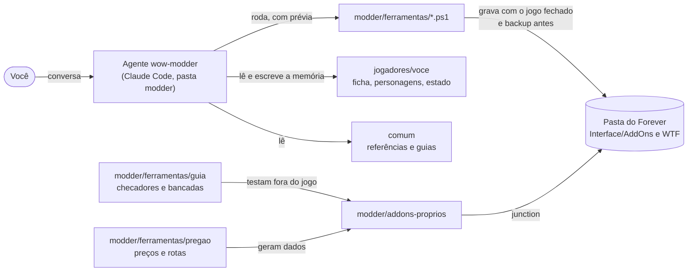

# WoW Forever: agentes, ferramentas e addons

[](https://github.com/GMS00004/wow-forever/actions/workflows/testes.yml)

Um agente de IA (o **wow-modder**, que roda no [Claude Code](https://claude.com/claude-code)) que cuida dos addons e da interface do WoW Forever por você: escolhe e instala o pacote de addons, mantém tudo atualizado, faz backup do WTF, configura ElvUI, macros, teclas e CVars a partir dos guias que você segue, e diagnostica erro de Lua. Em volta dele, as ferramentas que ele usa (scripts com prévia antes de gravar), addons próprios escritos com ele e testes que rodam fora do jogo.

Serve para qualquer facção, reino e classe. Foi construído pelo Guilherme (Aliança) desde o lançamento do Forever, em 2026-11-04, e aberto aos amigos (Horda, reino PvP, várias classes) em 2026-11-26.

| Quero... | Vá para |
|---|---|
| usar no meu PC | [docs/COMECE-AQUI.md](docs/COMECE-AQUI.md) |
| entender como funciona | [docs/ARQUITETURA.md](docs/ARQUITETURA.md) |
| saber o que cada addon próprio faz e se serve para a minha classe | [modder/addons-proprios/LEIA-ME.md](modder/addons-proprios/LEIA-ME.md) |
| entender um termo (TOC, WTF, Interface, valor secreto...) | [docs/GLOSSARIO.md](docs/GLOSSARIO.md) |
| mandar uma melhoria | [CONTRIBUTING.md](CONTRIBUTING.md) |
| ler o que se aprendeu construindo | [docs/licoes/](docs/licoes/LEIA-ME.md) |

## O que serve para você hoje

| Peça | Para qualquer jogador? | O que precisa |
|---|---|---|
| Agente wow-modder: curadoria, instalação, atualização, auditoria, backup do WTF, CVars, SavedVariables, diagnóstico | sim | Claude Code e a sua pasta de jogador ([como criar](jogadores/LEIA-ME.md)) |
| Pacote base de addons (ElvUI, Questie, DBM, BugSack, Auctionator e outros) | sim | o agente propõe e instala com o seu ok ([lista](comum/referencia/pacote-base.md)) |
| Ferramentas de preço e de custo de profissão (`modder/ferramentas/pregao`) | sim, com a casa de leilão da sua facção | o `casaLeilao` no seu `jogador.json` (Horda PvP é a 113) |
| CentralForever: dano, DPS e threat da luta | sim | o papel por classe está no `Config.lua` (hoje só o paladino conta como tanque) |
| CompraForever: leilão, compra e rota de profissão num clique por ação | o código sim; os dados vêm da casa e das rotas do Guilherme | gerar os dados com a sua casa ([issue #2](https://github.com/GMS00004/wow-forever/issues/2)) |
| GuiaForever: talentos, pets, profissões e treinadores no jogo | o código lê classe e facção; o conteúdo cobre caçador e paladino da Aliança | o conteúdo da sua classe, a partir dos seus guias |
| UIForever: layout do ElvUI, teclas e barras | o layout sim, se gostar do do Guilherme; as magias nas barras só para caçador e paladino | o mesmo: dados da sua classe |

O que falta para Horda e outras classes está nas [issues](https://github.com/GMS00004/wow-forever/issues), e quem joga essas classes é quem melhor testa.

## Três jeitos de usar

1. **Com o agente (o jeito pensado):** abra o Claude Code na pasta `modder` e converse. Ele roda as ferramentas, mostra a prévia de tudo que vai gravar e espera o seu ok. O passo a passo está em [docs/COMECE-AQUI.md](docs/COMECE-AQUI.md).
2. **Só as ferramentas, na linha de comando:** os scripts de `modder/ferramentas` funcionam sozinhos, com prévia por padrão e `-Aplicar` para gravar (contrato em [modder/ferramentas/CONTRATO.md](modder/ferramentas/CONTRATO.md)); as ferramentas de preço são Node puro ([mapa](modder/ferramentas/LEIA-ME.md)).
3. **Só os addons:** copie a pasta do addon para `<pasta do Forever>\Interface\AddOns` (ou ligue com o `dev-link.ps1`, que cria uma junction e deixa você editar no repositório).

## Começo rápido

Pré-requisitos: Windows 10 ou 11 (as ferramentas são Windows PowerShell 5.1, que já vem no Windows), [Git](https://git-scm.com), [Node 24](https://nodejs.org) (para as ferramentas de preço e os testes) e o Claude Code (para o agente).

```powershell
git clone https://github.com/GMS00004/wow-forever.git C:\jogos\wow-forever
cd C:\jogos\wow-forever\modder
powershell -NoProfile -ExecutionPolicy Bypass -File ferramentas\jogador.ps1 -Novo seuapelido -Aplicar
claude
```

Na primeira conversa, diga "oi". O agente vê que o seu bootstrap está pendente e conduz o resto: acha o jogo, pergunta facção, reino, personagens e guias, e propõe o pacote de addons. Clone num caminho curto (o Windows limita caminhos a 260 caracteres, e alguns addons têm pastas fundas).

## Como funciona, em uma figura



O agente não lembra de nada entre sessões: a memória dele é a sua pasta de jogador (addons instalados, decisões, mudanças de UI, pendências e diário). Os scripts são a única coisa que grava na pasta do jogo, sempre com prévia, com o jogo fechado e com backup antes. Detalhes em [docs/ARQUITETURA.md](docs/ARQUITETURA.md).

## O que tem aqui

| Pasta ou arquivo | O que é |
|---|---|
| [`CLAUDE.md`](CLAUDE.md) | o contexto comum de todos os agentes (limites, protocolo de verificação, estilo de resposta); é instrução para a IA, não documentação |
| [`modder/`](modder/) | a pasta do agente wow-modder: abra o Claude Code aqui |
| [`modder/.claude/agents/wow-modder.md`](modder/.claude/agents/wow-modder.md) | o prompt do agente (o que ele faz, a memória, a abertura de sessão, o bootstrap, as regras de autonomia) |
| [`modder/ferramentas/`](modder/ferramentas/LEIA-ME.md) | os scripts do gerenciador de addons (PowerShell), os checadores e bancadas dos addons e as ferramentas de preço (Node) |
| [`modder/addons-proprios/`](modder/addons-proprios/LEIA-ME.md) | os addons escritos aqui, mais o modelo para um addon novo |
| `modder/HANDOFF-*.md` | frentes de trabalho do Guilherme em andamento (notas para retomar uma tarefa numa sessão nova) |
| [`jogadores/`](jogadores/LEIA-ME.md) | o modelo da pasta de jogador; a sua (personagens, instalação e a memória do agente) fica só no seu PC, fora do git |
| [`comum/referencia/`](comum/referencia/) | fatos do Forever com fonte e data, o pacote base, a API e as profissões |
| [`comum/fontes/`](comum/fontes/LEIA-ME.md) | a biblioteca de guias de gameplay (builds, macros, leveling, profissões) que os jogadores seguem |
| [`docs/`](docs/) | começo, arquitetura, glossário e lições |

## Limites (não mudam)

1. Só addon pela API oficial do jogo.
2. Nada de alterar arquivo do cliente, automação, bot, leitura de memória, unlocker ou injeção.
3. Nunca contornar os valores secretos de combate nem as funções protegidas, nem em addon próprio.
4. Na pasta do jogo só se escreve em `Interface\AddOns` e `WTF`, pelos scripts, com o jogo fechado e backup antes.

Gameplay (build, rotação, rota de quests, economia) não é opinião do agente: vem dos guias que você escolhe em `comum/fontes`.

## Testes

```powershell
cd C:\jogos\wow-forever\modder\ferramentas\guia
npm ci
node baixar-api-forever.mjs
cd ..
powershell -NoProfile -ExecutionPolicy Bypass -File testar-tudo.ps1
```

São 10 suítes de PowerShell (604 verificações, com uma instalação falsa do jogo e respostas de rede gravadas) e 38 checagens em Node: sintaxe Lua 5.1, regras de combate contra a lista da API do Forever, um simulador de valor secreto, bancadas que rodam os addons no [fengari](https://github.com/fengari-lua/fengari) com cenários e mutantes, e os testes das ferramentas de preço. O CI roda o mesmo comando em todo push e PR; o que depende de dados baixados do jogo sai como PULADO lá.

## Histórico

Os commits de 2026-11-03 a 2026-11-26 vieram do repositório pessoal do Guilherme: só a pasta do WoW, com o histórico dela, sem os dados pessoais dele (diário do agente, fichas e instalação), que seguem num repositório privado. Os commits `wip(sync)` são fotos automáticas do sync entre os dois notebooks dele; daqui em diante essas fotos vão para um espelho privado e não entram no `main`.

## Créditos

Os guias, builds e dados usados aqui são dos criadores e projetos listados em [CREDITOS.md](CREDITOS.md). O repositório é público e não tem licença aberta: ler, aprender e mandar PR pode; reaproveitar o código em outro projeto pede a autorização do Guilherme.
