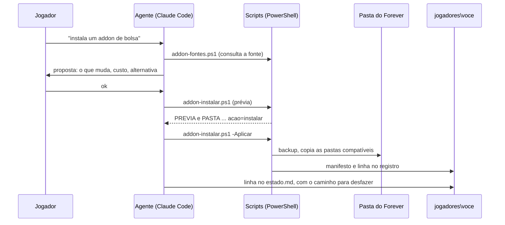

# Arquitetura

Como as peças se encaixam e por que foram feitas assim. Para usar, comece por [COMECE-AQUI.md](COMECE-AQUI.md); os termos estão no [GLOSSARIO.md](GLOSSARIO.md).

## As quatro camadas

| Camada | Onde | Papel |
|---|---|---|
| Agente | `modder\.claude\agents\wow-modder.md` e `CLAUDE.md` | decide o que fazer, conversa, pede ok, registra |
| Ferramentas | `modder\ferramentas\` | fazem: leem e gravam na pasta do jogo (PowerShell), testam e calculam fora do jogo (Node) |
| Addons próprios | `modder\addons-proprios\` | rodam dentro do jogo, ligados por junction |
| Dados do jogador | `jogadores\<apelido>\` | a memória: ficha, personagens, instalação, estado |

Mais duas pastas de conhecimento, iguais para todos: `comum\referencia\` (fatos do Forever com fonte e data) e `comum\fontes\` (os guias de gameplay).

## O agente

O wow-modder é um subagente do Claude Code. O `modder\.claude\settings.json` faz dele o agente padrão da pasta (`"agent": "wow-modder"`) e libera, sem perguntar, só os comandos `powershell ... -File ferramentas\*`. O prompt dele cobre o escopo, a memória, a abertura de sessão, o bootstrap de um jogador novo, as regras de autonomia, a curadoria de addons, a UI, o diagnóstico e a criação de addons. O `CLAUDE.md` da raiz é o contexto comum de todos os agentes de WoW: os limites fixos, o protocolo de verificação, a fronteira de gameplay e o estilo de resposta.

Três regras explicam quase todo o comportamento dele:

1. **Gameplay não é opinião dele.** Build, rotação, rota e economia vêm dos guias que o jogador escolheu; sem guia, ele pergunta qual seguir.
2. **Fato do Forever precisa de fonte.** Versão, Interface e compatibilidade só entram numa resposta se estiverem em `comum\referencia\` com fonte e data, ou se acabaram de ser conferidos; o fato novo vai para lá com a marca de como foi lido (`[local]`, `[página]` ou `[busca]`). A compatibilidade de um addon se confere pelo TOC, não pela página do autor.
3. **Autonomia limitada.** Atualizar um addon já aprovado roda sozinho na abertura; addon novo, remoção, volta de versão e qualquer mudança de UI mostram a prévia e esperam ok.

## A memória

O agente não lembra de nada entre sessões. A memória é a pasta do jogador ativo, que o `jogador-ativo.txt` da raiz aponta (fora do git, uma linha com o apelido):

| Arquivo | Quem escreve | Observação |
|---|---|---|
| `estado\addons\<slug>.json` | só os scripts | o manifesto de cada addon: fonte, versão, pastas com hash, aprovação; é a fonte de verdade dos scripts |
| `estado\registro.md` | só os scripts | append-only, uma linha por ação |
| `estado\sessao.json` | só os scripts | a última Interface vista, para avisar quando um patch muda a API |
| `estado\estado.md` | o agente | o diário: addons, decisões, mudanças de UI com o caminho para desfazer, pendências |
| `instalacao.json` | só os scripts | onde o jogo está neste PC |
| `jogador.md`, `jogador.json`, `personagens\` | o agente, com o jogador | perfil, casa de leilão, fichas |

A pasta do Bruno vai no git, como exemplo de uma pasta em uso há semanas; a dos outros jogadores fica no PC de cada um, para os PRs levarem ferramenta e conteúdo, não estado de sessão. Os `HANDOFF-*.md` de `modder\` são notas de trabalho em andamento do Bruno, para retomar uma frente numa sessão nova.

## O gerenciador de addons (PowerShell)

Windows PowerShell 5.1, sem módulos externos, para rodar em qualquer Windows sem instalar nada. O contrato completo está em [modder/ferramentas/CONTRATO.md](../modder/ferramentas/CONTRATO.md).

| Peça | Como funciona |
|---|---|
| Fontes | release do GitHub (com o `release.json` do empacotador, que diz qual arquivo é de qual flavor), API da Tukui (ElvUI) e zip (baixado do Wago pelo agente ou, quando só existe na CurseForge, que recusa cliente automático, com um clique do jogador) |
| Compatibilidade | a Interface do cliente sai do `.build.info` (1.60.1 dá 16001) e se compara com o `## Interface` de cada TOC; pacotes de várias versões do jogo entram com `-SoCompativeis` ou `-SoPastas`, e o filtro fica no manifesto |
| Instalação | renomeia as pastas antigas, copia as novas e, se algo falhar no meio, desfaz tudo; a versão substituída vai para um zip de backup (três por addon) |
| Addon próprio | `dev-link.ps1` cria uma junction de `addons-proprios\<Nome>` para `AddOns`; nenhum script apaga recursivamente uma junction (no PowerShell 5.1 isso apagaria o alvo) |
| WTF | backup em zip a cada abertura de sessão (os últimos 20), CVars no `Config.wtf` preservando a codificação, SavedVariables só com o jogo fechado |
| Auditoria | só leitura, roda com o jogo aberto: pasta desconhecida, faltando, alterada (por hash), TOC incompatível, dependência ausente e junction quebrada |
| Saída | uma linha por fato, com prefixo em maiúsculas e `chave=valor`; códigos 0, 1, 2 e 3 |

Os testes (`testes\t-*.ps1`) rodam cada script como processo filho contra uma instalação falsa do jogo (`testes\fixture\`, com um `Config.wtf` em CRLF e um `.build.info` inventado), addons de exemplo e respostas de rede gravadas (`WOWAGENTE_RESPOSTAS`), sem rede e sem tocar no jogo de verdade.

## Os addons e os testes fora do jogo

Não há interpretador Lua no Windows do projeto, então os addons se testam em Node:

| Ferramenta | O que pega |
|---|---|
| `checar-lua.mjs` (luaparse) | sintaxe Lua 5.1, texto só ASCII, escape inválido em string, globais criadas sem querer |
| `checar-combate.mjs` | regras numeradas (R1 em diante) contra a lista da API do Forever: chamada protegida sem guarda de combate, API cujo retorno vira valor secreto, função, evento ou template que não existe no Forever; perfis por addon |
| `bancada\segredo.lua` e `rodar-casos-segredo.mjs` | um simulador de valor secreto: o valor em combate se comporta como no cliente (dá para mandar para a tela, não para comparar nem fazer conta), para provar que o addon não tenta ler o que não pode |
| `rodar-janela.mjs` (fengari) | roda o GuiaForever fora do jogo num personagem simulado, abre cada aba e desenha a janela |
| `rodar-central.mjs` (fengari) | cenários de combate do CentralForever, uma matriz das incógnitas (408 combinações) e um autoteste em que mutantes do addon têm de ser acusados |
| `pregao\bancada-pregao.mjs` (fengari) | grupos de cenários do PregaoForever e do CompraForever (compra, rota, dados, fatura e as unidades de cada módulo) |
| `conferir-doc.mjs` | âncoras na documentação gerada da Blizzard (as marcas de valor secreto de que o CentralForever depende) |

A lista da API e a documentação vêm de dois espelhos públicos do cliente (`Ketho/BlizzardInterfaceResources` e `Ketho/wow-ui-source-forever`), baixados pelo `baixar-api-forever.mjs` nos commits fixados em `api-forever.json`, com o hash de cada arquivo conferido.

## As ferramentas de preço

| Dado | De onde vem |
|---|---|
| preço de leilão da hora | o arquivo público por casa de leilão do `RuslanMunasipov/quest-murder-prices` (o Forever não tem reino: uma casa por região, ruleset e facção) |
| scan do jogador | a exportação do Auctionator que o GuiaForever guarda nas SavedVariables, e o Full scan do CompraForever |
| receitas, itens e perícias | as tabelas do cliente do wago.tools (ItemSparse, SkillLineAbility e outras), com cache em `modder\dados` |
| treinador, custo de treino e padrões | a tabela do Naowh Forever e a lista de vendedores do QuestieDB |

O caminho é: `baixar-precos.mjs` grava o `precos.json`; `crafts.mjs`, `rota.mjs` e `legado.mjs` calculam o que paga, a rota mais barata de perícia e o custo do Legacy point; `estimativas.mjs` refaz tudo num comando e grava o `rotas.json`; `compra\gerar-dados.mjs` transforma isso no `Dados.lua` que o CompraForever lê no jogo. A casa de leilão e a facção vêm do `jogador.json` do jogador ativo (ou de `--casa` e `--faccao`).

## O CI

`.github\workflows\testes.yml` roda o `testar-tudo.ps1` num Windows limpo em todo push no `main` e em todo PR. Dois workflows pequenos fazem o papel da trava que o plano Free da GitHub não dá em repositório privado: `aviso-push-main.yml` abre uma issue para o Bruno quando alguém que não é ele muda o `main`, e `pedir-revisao.yml` pede a revisão dele em todo PR de outra pessoa.

## Por que assim

| Escolha | Motivo | O que se perderia na alternativa |
|---|---|---|
| Windows PowerShell 5.1 puro | já vem no Windows; ninguém instala nada para o gerenciador funcionar | com PowerShell 7 ou módulos, um passo a mais em cada PC |
| Prévia por padrão e `-Aplicar` | o agente mostra o que vai mudar antes de mudar, e o jogador decide | gravar direto deixaria o erro do agente chegar no jogo sem ninguém ver |
| Só grava com o jogo fechado | o cliente regrava WTF e SavedVariables ao sair e sobrescreveria a mudança | mudança perdida ou arquivo corrompido |
| Backups fora do repositório | o WTF tem dados da conta, e o repositório é compartilhado | o WTF de todo mundo no git |
| Um jogador por pasta | cada um tem a própria memória, e o motor é o mesmo para todos | um repositório por jogador, e cada melhoria copiada à mão |
| Testes em Node com fengari | não há interpretador Lua no ambiente, e a bancada roda o addon de verdade | só testar no jogo, um `/reload` por tentativa |
